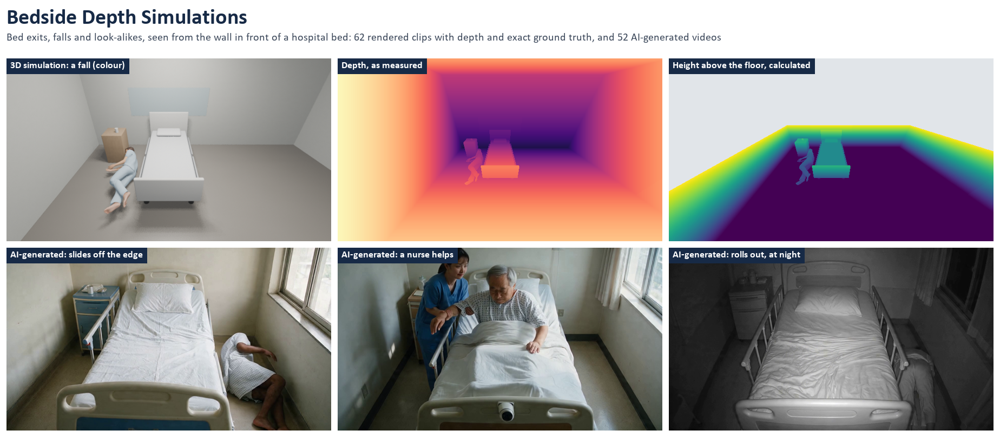
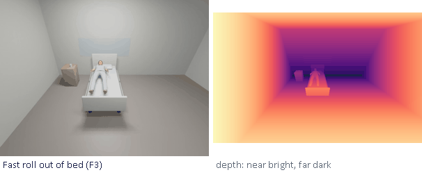
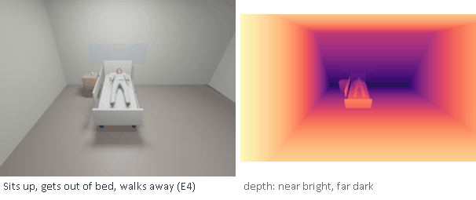
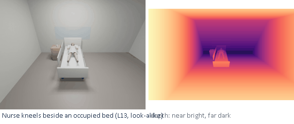
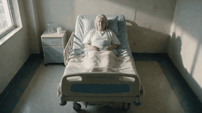
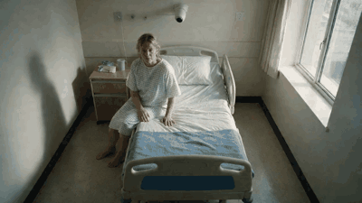
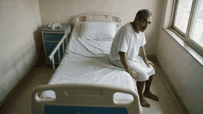
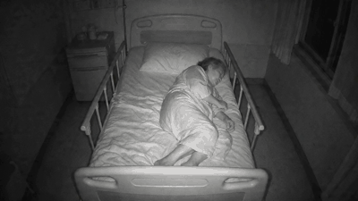
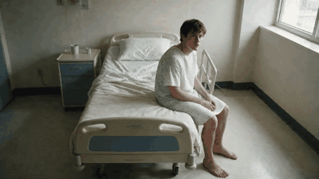
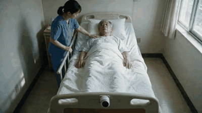

# Bedside Depth Simulations

[](https://doi.org/10.5281/zenodo.23926720)
[](LICENSE)
[](LICENSE-CODE)

**Bed exits, falls and look-alike movements, seen by a depth camera on the wall in front of a hospital bed.** The dataset has two parts:
- **3D simulations:** 62 rendered clips, each with depth for every frame and exact ground truth.
- **AI-generated videos:** 52 hospital videos made from the same camera position.

The dataset also includes simple detection rules as a baseline, with their results.



## Why this dataset

A depth camera on the wall at the foot of a hospital bed sees the whole bed and the floor beside it. Systems that alert staff when a patient sits up, gets out of bed or falls can use such a camera. Of the 53 public datasets we checked, none shows real patients leaving hospital beds from this position.

From there, a patient lying down looks upright in the picture, so simple pose rules cannot tell lying from sitting. Depth fixes that, but testing it needs depth, exact event times and true body positions. This dataset provides them, from a camera with the fields of view of a Luxonis OAK-D Pro W.

## Gallery

**3D simulations:** colour (left) and depth as measured (right). Each clip also has a grey infrared-like video, exact event times and 3D body points.

| | | |
|:--:|:--:|:--:|
|  |  |  |
| Fast roll out of bed (R45) | Sits up, gets out of bed, walks away (R05) | Nurse kneels beside an occupied bed: a look-alike (R57) |

**AI-generated videos:** colour only.

| | | |
|:--:|:--:|:--:|
|  |  |  |
| Legs over the edge (Wan 2.2) | Stands up and walks away (Wan 2.2) | Slides off the edge to the floor (Wan 2.2) |
|  |  |  |
| Rolls out of bed, at night (Wan 2.2) | Sits on the edge, lies back: a look-alike (Wan 2.2) | A nurse helps the patient up: a look-alike (Wan 2.2) |

## At a glance

| | 3D simulations | AI-generated videos |
|:--|:--|:--|
| Clips | 62 (R01 to R62), 5 to 14 s, 15 frames per second | 52, 5 to 8 s, 1280 x 720 (16 or 24 frames per second) |
| What each gives | colour video, grey infrared-like video, 16-bit depth per frame, event times, 3D body points per frame, camera calibration | colour video; the start picture, prompt, settings and seed; a camera-stillness measure |
| Events | sitting up, leaving the bed, falls of eight kinds | sitting up, legs over the edge, standing up, falls of three kinds |
| Look-alikes | turning in bed, lying back down, sitting on a chair, blanket or bag on the floor, nurse kneeling, putting on slippers, walking away | turning, reaching, lying back down, a nurse helping |
| People | two computer bodies (MakeHuman, CC0): a man of about 74, a woman of about 79 | invented by the models |
| Made with | Blender 4.5 and MPFB 2 | Seedream 5.0 Pro (start pictures); Wan 2.2 (32), Veo 3.1 Fast (16), Seedance 2.0 (4) |
| Size | 282 MB (201 MB zipped) | 135 MB |

## Download

The data is on Zenodo: **https://doi.org/10.5281/zenodo.23926720**

| File | What |
|:--|:--|
| `bedside-depth-sim_v1.0_data.zip` | the 62 simulated clips, with metadata and documentation |
| `bedside-depth-sim_v1.0_generated.zip` | the AI-generated part, with its tables |
| `b1_*.mp4`, `b2_*.mp4`, `SF*.png` | the same AI-generated videos and start pictures as single files, to watch or download one at a time |
| `bedside-depth-sim_v1.0_repository.zip` | a snapshot of this repository |

Unzip the archives next to this repository, so that `data/` sits beside `metadata/`. Then check every file:

```
sha256sum -c metadata/SHA256SUMS.txt
sha256sum -c metadata/SHA256SUMS_generated.txt
```

## Quick start

```
pip install numpy pillow scipy
python code/load_clip.py data/R45     # one clip: events, depth range, floor height, hip height
python baseline/evaluate.py data       # run the locked rules on every clip
```

In Python:

```python
import sys; sys.path.insert(0, "code")   # the loader lives in code/
from load_clip import load, room_points
meta, truth, depth_m = load("data/R45")   # depth_m: (frames, 400, 640), metres, 0 = no data
xyz = room_points(depth_m[0], meta)       # every pixel in room coordinates (metres, z up, floor at 0)
```

## What is inside

```
data/R45/                       one folder per simulated clip
  R45_colour.mp4                colour video (640 x 480)
  R45_grey.mp4                  grey infrared-like video (640 x 400, the depth camera's pixels)
  depth/R45_depth_000000.png    depth per frame: uint16 millimetres, 0 = no data
  R45_background_depth.png      the empty room's depth (R41 to R62)
  R45_ground_truth.json         per frame: 24 body points in 3D and in pixels, visibility, hip height, trunk angle
  R45_meta.json                 camera, events and their rules, scenario, people, objects, render settings
  R45_motion.json               the keyed motion
  R45_contact_sheet.png, keyframes/
data/generated/videos/          the AI-generated videos (b1_SW1_a1.mp4 ...)
data/generated/start_pictures/  the start pictures they begin from (SF1.png ... SF12.png)
metadata/                       clips.csv, scenarios.csv, generated_videos.csv, generated_start_pictures.csv, checksums
baseline/                       locked detection rules, their results, the body points they read
code/                           load_clip.py; render/ (the Blender pipeline that made the clips)
docs/                           FORMATS.md (every file and field), KNOWN_ISSUES.md, media/
DATASHEET.md                    the questions of "Datasheets for Datasets", answered
```

`docs/FORMATS.md` gives every convention: coordinates, time, depth, the camera calibration and each column of the tables.

## The 3D simulations

Each clip shows a patient in a hospital room, and in four clips a second person (a nurse or a visitor). A virtual camera is placed where a wall-mounted depth camera would hang: on the wall at the foot of the bed, looking along it. Six clips of the first set use other camera positions for comparison.

The clips were made in three sets. Each set was made after a version of the baseline rules was locked, so each is a fair test of the rules locked before it:

| Set | Clips | What it holds |
|:--|:--|:--|
| Design | R01 to R22 | One sit-up, one bed exit and one roll out of bed, each from seven camera positions, and one turn in bed. Used while designing rules |
| Fresh | R23 to R40 | Falls after standing and from the edge of the bed, a roll out of bed, lying back down, sitting down quickly on a chair; two bodies; cameras at 2.2 and 1.8 m |
| Floor check | R41 to R62 | 10 falls (5 kinds, each by both bodies) and 12 look-alikes, each with the empty room's depth. Labelled for the fall alert only |

`metadata/clips.csv` lists every clip: set, scenario, expected alerts, body, camera, frames and event times.

**How they were made:**
- **Software:** Blender 4.5.14 LTS (Eevee) with MakeHuman / MPFB 2.0.18 bodies (CC0).
- **Motion:** keyed by hand. A solver keeps each body on the mattress, chair or floor.
- **Event times:** measured on the rendered body by fixed rules, written into each clip's metadata.
- **Camera:** has the OAK-D Pro W's published fields of view, aimed at the centre of the mattress.
- **Rebuilding:** `code/render/` holds the pipeline; `code/README.md` explains how to run it.

## The AI-generated videos

They show what a patient looks like from this camera position in realistic hospital rooms.

**How they were made**, all through the fal.ai service:
1. **Start pictures:** twelve were drawn from text alone by Seedream 5.0 Pro, each a still from a camera high on the wall at the foot of a hospital bed.
2. **Videos:** each picture was animated with a prompt naming one event or look-alike, by Wan 2.2 A14B (32 videos, in two batches), Veo 3.1 Fast (16) or Seedance 2.0 (4).
3. **Records:** `metadata/generated_videos.csv` gives every video's model, prompt, settings, seed and time.

Each file is exactly as the service returned it and matches the checksum recorded when it was made. Each keeps its makers' provenance marks: C2PA manifests, and Google's SynthID in the Veo videos.

**Before you use them:**
- **Labels:** the scenario is what the prompt asked for. Whether each video shows it has not been checked by blind labelling.
- **Camera:** in 13 of the 16 Veo videos and 4 of the 32 Wan videos the camera zooms or shifts by more than 1.5% (`camera_moved`). A wall camera never moves.
- **Format:** no depth, no ground truth.

## Baseline

`baseline/` holds simple detection rules, each locked (with checksums) before the clips that judge it were made. It also holds the body points they read (RTMPose-m with the YOLOX-m person finder) and their results. The release build checks that `baseline/evaluate.py` reproduces those results exactly.

| Rules | What they do | Judged on | Result |
|:--|:--|:--|:--|
| v1, v2 | posture from the trunk's angle in the picture | 44 AI-generated videos | from this camera, a lying patient looks upright: no requested sit-up caught |
| v3 | posture from depth | design set | 11 of 22 clips exactly right; every sit-up and bed exit seen from the wall in front of the bed; no falls |
| v4 | v3 plus a fast drop to the floor | fresh set | 10 of 18 clips; stand-ups 4 of 4, look-alikes quiet 8 of 8, falls 2 of 10 |
| v5 | v4 plus a floor check on depth alone | floor-check set | falls 10 of 10; look-alikes with a fall alert 1 of 12 |

These are small samples from simulation, and several clips show one motion from several cameras. They show what the rules do on this material, not how they would do in a hospital. `baseline/RESULTS.md` lists every clip and explains a fault found in v5 after scoring.

## Read before use

`docs/KNOWN_ISSUES.md` lists everything wrong or simplified. The main points:

- **Ideal depth, seen from the camera.** No noise, no holes, no minimum range; real depth is worse, and gets worse with distance. Depth measures the body's surface, which reads 6 to 14 cm above the joint heights of the ground truth.
- **An exactly known camera pose.** A real camera must estimate its tilt. A 2° error moves the floor about 9 cm at 3.6 m.
- **A simple lens.** A pinhole lens with the published fields of view: people near the centre look about 45% smaller than through the real lens.
- **Lifted fallen bodies.** In R07 to R09, R19 to R26 and R31 to R36 the fallen body rests on one hand, 10 to 19 cm above the floor. The falls of R41 to R50 lie flat.
- **Hand-keyed motion, one room, two bodies.**

## Intended use

Testing and comparing methods that detect bed exit, standing and falls from a camera in front of a bed. Also studying how camera position changes what a method sees, and testing pose models on older bodies lying, sitting and falling near a bed.

**Not for** clinical validation, or as evidence that a method works on real patients.

## Ethics

- **3D simulations:** all people are computer models built from CC0 assets.
- **AI-generated part:** the people are invented by the models. The start pictures were made from text alone, with no photograph of a real person as input.
- **No real people:** the dataset holds no recordings of real people and no patient data.

## Licence

- **Data, both parts** (`data/`, `metadata/`, `baseline/body_points/`, `baseline/results/`, the documentation): [Creative Commons Attribution 4.0 International](LICENSE). You may use, share and adapt it for any purpose, including commercially, as long as you give credit by citing the dataset. When you use the AI-generated files, also say that they are AI-generated and which model made them (`metadata/generated_videos.csv`).
- **Code** (`code/load_clip.py`, `baseline/`): [Apache License 2.0](LICENSE-CODE).
- **The Blender pipeline** (`code/render/`): [GNU GPL 3.0 or later](code/render/LICENSE), because Blender's licence asks that published scripts using its Python API be GPL-compliant.

The services that made the AI-generated files have their own terms; none of them claims ownership of the outputs.

## Citation

If you use this dataset, please cite it:

> Afsharghoochani, S. (2026). *Bedside Depth Simulations: rendered bed exits, falls and look-alikes seen by a depth camera in front of a hospital bed* (Version 1.0) [Data set]. Zenodo. https://doi.org/10.5281/zenodo.23926720

```bibtex
@dataset{afsharghoochani_2026_bedside,
  author    = {Afsharghoochani, Shahabeddin},
  title     = {Bedside Depth Simulations: rendered bed exits, falls and look-alikes seen by a depth camera in front of a hospital bed},
  year      = {2026},
  version   = {1.0},
  publisher = {Zenodo},
  doi       = {10.5281/zenodo.23926720},
  url       = {https://doi.org/10.5281/zenodo.23926720}
}
```

`CITATION.cff` gives the same in machine-readable form; GitHub shows it under "Cite this repository".

## References

Tools and models used to make or score the data:

- Blender 4.5 LTS. Blender Foundation. https://www.blender.org
- MPFB 2 (MakeHuman for Blender) and the MakeHuman system assets (CC0). MakeHuman Community. https://static.makehumancommunity.org
- Jiang T. et al. RTMPose: Real-Time Multi-Person Pose Estimation based on MMPose. arXiv:2303.07399, 2023.
- Ge Z. et al. YOLOX: Exceeding YOLO Series in 2021. arXiv:2107.08430, 2021.
- rtmlib 0.0.16. https://github.com/Tau-J/rtmlib
- Wan 2.2. Alibaba, Wan team. https://github.com/Wan-Video/Wan2.2
- Veo 3.1. Google. https://ai.google.dev/gemini-api/docs/veo
- Seedream 5.0 and Seedance 2.0. ByteDance. https://www.byteplus.com
- fal.ai, the service through which the generated files were made. https://fal.ai
- Luxonis OAK-D Pro W, whose published fields of view the virtual camera uses. https://docs.luxonis.com
- Gebru T. et al. Datasheets for Datasets. Communications of the ACM 64(12), 2021, pp. 86 to 92.

## Contact

Shahabeddin Afsharghoochani, Iowa State University ([ORCID 0009-0000-3682-0471](https://orcid.org/0009-0000-3682-0471)). Questions and corrections: please open an issue on this repository.
